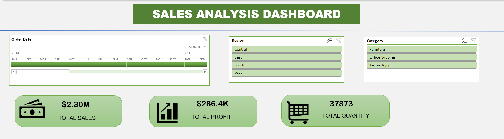
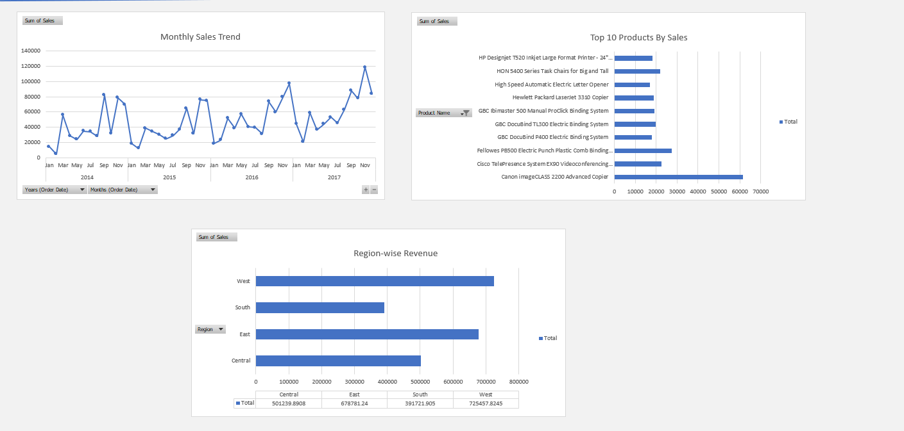

# Excel Sales Analysis Dashboard

An interactive sales dashboard built in Microsoft Excel using the Superstore dataset.

## Dashboard Preview

## Features

- KPI cards for Total Sales, Total Profit and Total Quantity, linked to pivot tables
- Order Date timeline with Region and Category slicers connected to all pivots
- Monthly sales trend chart
- Top 10 products chart
- Region-wise revenue chart
- All cards and charts update together when filters are changed

## Tools Used

- Microsoft Excel (Pivot Tables, Pivot Charts, Slicers, Timeline)

## Dataset

Superstore sales dataset

## File

Sales_Dashboard.xlsx (download it and open in Excel to use the filters)
